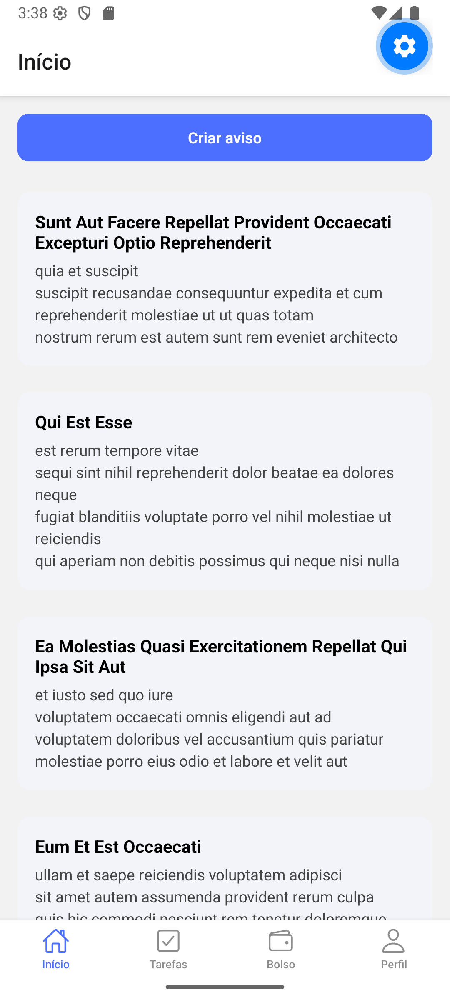
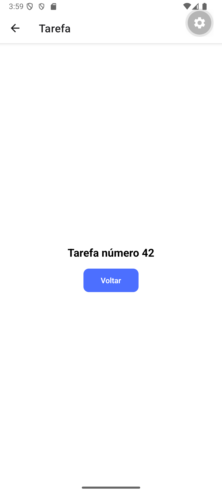
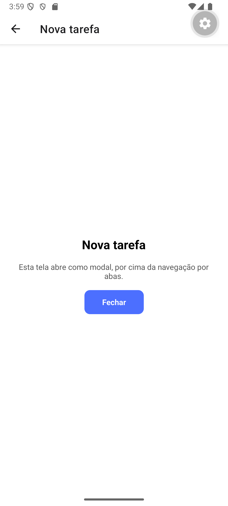
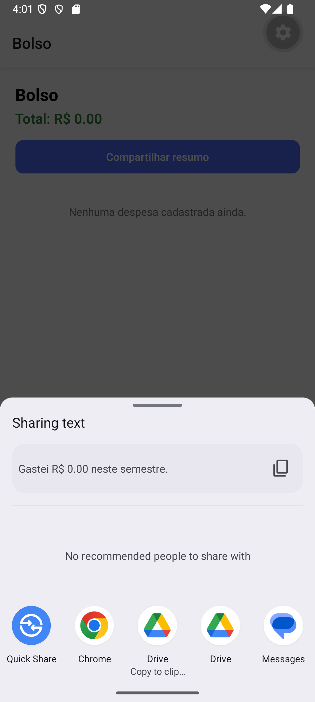
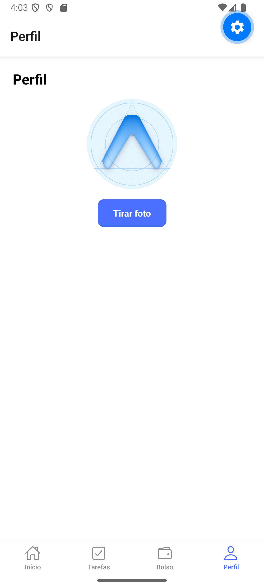
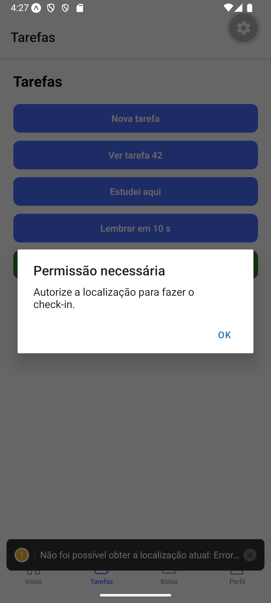
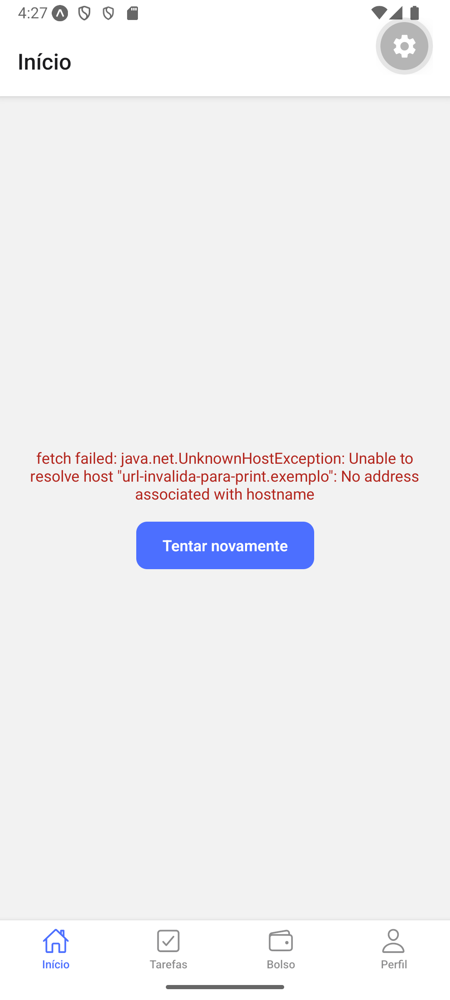

# 🧭 CampusGo

**Atividade Prática — Expo Router, Recursos do Celular e Consumo de API**
Disciplina: Programação para Dispositivos Móveis
Professor: Marcelo Alves Farias — IESB
Aula de referência: Aula 10 — Expo Router e Recursos Nativos
Continuidade: Atividade do Gerenciador de Despesas 2.0 (Aula 09)

## Objetivo

App novo (não é o Gerenciador de Despesas) que reúne as três práticas da Aula
10 num app só: **rotas por arquivos** (Expo Router), **recursos nativos com
permissão** (câmera, galeria, localização, notificação local, vibração) e um
**mural de avisos** consumido de uma API, com os três estados de tela
(carregando, erro, sucesso).

## Comando usado para criar o projeto

```bash
npx create-expo-app@latest campus-go --template blank
npx expo install expo-router react-native-safe-area-context react-native-screens expo-linking expo-constants
```

Demais dependências nativas, também via `expo install` (nunca `npm install`
puro, para resolver as versões compatíveis com o SDK do projeto):

```bash
npx expo install @react-native-async-storage/async-storage expo-image-picker expo-location expo-notifications expo-haptics
```

## Como rodar

```bash
cd campus-go
cp .env.example .env
npm install
npx expo start
```

Escaneie o QR Code com o **Expo Go** ou rode num emulador Android (`a` no
terminal do Metro). A URL da API **não** está escrita no código — ela vem de
`EXPO_PUBLIC_API_URL`, definida no `.env` (veja `.env.example`).

## Estrutura

```text
campus-go/
├── app/
│   ├── _layout.js            # Stack raiz: (tabs) sem header, task/[id], new-task como modal
│   ├── new-task.js           # Tela do modal "Nova tarefa" (Fechar -> router.back())
│   ├── task/[id].js          # Detalhe lido da URL com useLocalSearchParams
│   └── (tabs)/
│       ├── _layout.js        # Tabs: Início, Tarefas, Bolso e Perfil (ícones Ionicons)
│       ├── index.js          # Mural de avisos (useNotices + FadeIn + pull-to-refresh)
│       ├── tasks.js          # Nova tarefa, detalhe, check-in, lembrete, Concluir (Haptics)
│       ├── wallet.js         # Bolso: total das despesas + Compartilhar resumo
│       └── profile.js        # Avatar (galeria) + Tirar foto (câmera) persistidos no AsyncStorage
├── components/
│   └── FadeIn.js             # Wrapper de surgimento com Animated (sem lib externa)
├── hooks/
│   └── useNotices.js         # notices / isLoading / error / reload (busca posts?_limit=10)
├── services/
│   ├── api.js                 # fetch com EXPO_PUBLIC_API_URL; lança erro quando !response.ok
│   ├── location.js            # getCurrentPlace(): permissão + posição + endereço (ou null)
│   ├── media.js                # pickImage (galeria) e takePhoto (câmera), com permissão
│   └── notifications.js        # canal Android, permissão e scheduleReminder(title, seconds)
├── store/
│   └── expenses-context.js    # Copiado do Gerenciador de Despesas 2.0 (Aula 09), sem alterações
├── .env.example                # EXPO_PUBLIC_API_URL=https://jsonplaceholder.typicode.com
└── app.json                    # scheme: "campusgo"
```

## Requisitos atendidos

- **Tarefa 1 — Rotas por arquivos**: quatro abas (`(tabs)/_layout.js`) com
  ícone do Ionicons e título em português; `task/[id].js` lê o parâmetro da
  URL com `useLocalSearchParams`; `new-task.js` abre como modal
  (`options={{ presentation: 'modal' }}` no `Stack.Screen` do layout raiz) e
  fecha com `router.back()`. Nenhuma rota usa `NavigationContainer`.
- **Tarefa 2 — Bolso**: `app/_layout.js` envolve a `Stack` com
  `ExpensesContextProvider` (importado de `../store/expenses-context`); a
  aba Bolso lê `expenses` com `useExpenses()` e soma com `reduce` sobre
  `amount`; total mostrado com `toFixed(2)`; lista vazia não quebra; botão
  "Compartilhar resumo" chama `Share.share` com o total na frase.
- **Tarefa 3 — Perfil, câmera e localização**: `services/media.js` com
  `pickImage` e `takePhoto`, cada um pedindo a permissão correspondente antes
  de abrir; câmera negada mostra `Alert` com "Abrir ajustes"
  (`Linking.openSettings()` de `expo-linking`); tocar no avatar troca a foto
  pela galeria; a URI fica no `AsyncStorage` (`@profile-photo`) e é relida no
  `useEffect` da tela; `services/location.js` tem `getCurrentPlace`, que pede
  permissão de primeiro plano e devolve `null` se for negada — a aba Tarefas
  mostra `place.label` ou avisa com `Alert` sem quebrar.
- **Tarefa 4 — Lembrete, vibração e FadeIn**: `services/notifications.js`
  cria o canal Android, pede permissão e expõe `scheduleReminder(title,
  seconds)`; botão "Lembrar em 10 s" na aba Tarefas. Botão "Concluir" chama
  `Haptics.notificationAsync(Haptics.NotificationFeedbackType.Success)`
  dentro de um `try/catch` (não quebra se o emulador não vibrar) e mostra o
  `Alert` "Tarefa concluída". `components/FadeIn.js` usa `Animated` puro do
  React Native e envolve cada card do mural.
- **Tarefa 5 — Mural de avisos**: `.env`/`.env.example` com
  `EXPO_PUBLIC_API_URL`; `services/api.js` monta a URL a partir dessa
  variável e lança erro quando `response.ok` é falso; `hooks/useNotices.js`
  busca `posts?_limit=10` e devolve `notices`, `isLoading`, `error` e
  `reload` (o `finally` desliga o carregamento nos dois casos); a aba Início
  mostra `ActivityIndicator`, a mensagem de erro com "Tentar novamente", ou a
  `FlatList` com título e texto de cada aviso; puxar a lista para baixo
  aciona `reload` via `RefreshControl`; lista vazia mostra texto, não tela em
  branco.
- **Bônus — Criar aviso (+0,5)**: botão "Criar aviso" no topo do mural chama
  `api.create('posts', { title, body, userId: 1 })` e mostra o `id`
  devolvido pelo JSONPlaceholder num `Alert`.
- **Não implementado**: o bônus do ícone que pulsa com `react-native-reanimated`
  (`withSequence`/`withSpring`) ficou de fora desta entrega.

## Prints do PR

| As 4 abas / Mural | Detalhe `/task/42` | Modal "Nova tarefa" | Bolso + compartilhar |
| --- | --- | --- | --- |
|  |  |  |  |

| Perfil com foto | Check-in | Erro + "Tentar novamente" |
| --- | --- | --- |
|  |  |  |

> O check-in mostra o Alert de permissão/falha em vez de um endereço: o emulador usado não entrega uma localização simulada via `adb` para o provedor fundido do Google Play, só pela UI do Extended Controls. Em um dispositivo real (ou configurando a localização pela UI do emulador) o fluxo de sucesso mostra `place.label` normalmente.

## Entrega (fluxo Git)

```bash
git checkout -b feature/pratica08-campus-go
git add .
git commit -m "Feat: CampusGo - Expo Router, recursos nativos e mural de avisos"
git push origin feature/pratica08-campus-go
```

Em seguida, abra o Pull Request (sem `node_modules` e sem `.env`) e cole o
link aqui:

- **Link do PR**: https://github.com/CauaMata14/IESB-PDM-SUL/pull/8
